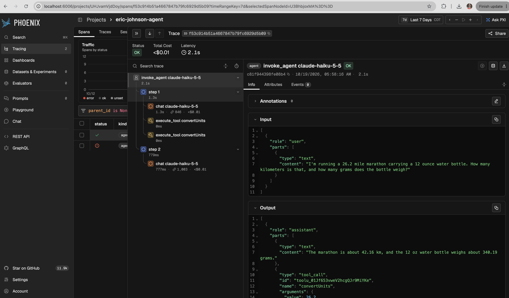

# eric-johnson-agent

A minimal [Vercel AI SDK](https://ai-sdk.dev/) v7 `ToolLoopAgent` with one
local, deterministic tool (`convertUnits`, a length/mass converter over an
in-memory table), traced to Phoenix with `@arizeai/phoenix-otel`.

Adapted from [`js/examples/apps/ai-sdk-agent`](../../js/examples/apps/ai-sdk-agent),
swapping OpenAI for Anthropic and the canned weather tool for a unit converter.
The default prompt needs two conversions, so the trace shows the agent span,
multiple LLM steps, and multiple tool calls.

## Prerequisites

- Node.js >= 22.12
- A running Phoenix instance (defaults to `http://localhost:6006`; see
  [DEVELOPMENT.md](../../DEVELOPMENT.md))
- An Anthropic API key

## Run

```shell
cd scripts/eric-johnson-agent
npm install
cp .env.example .env   # then set ANTHROPIC_API_KEY in .env (gitignored)
npm start
# or with your own prompt:
npm start -- "How many feet are in 3.5 kilometers?"
```

Open the link printed at the end, or the `eric-johnson-agent` project at
[http://localhost:6006](http://localhost:6006).

## Configuration

| Environment variable         | Description                          | Default                 |
| ---------------------------- | ------------------------------------ | ----------------------- |
| `ANTHROPIC_API_KEY`          | Anthropic API key                    | required                |
| `ANTHROPIC_MODEL`            | Model id                             | `claude-haiku-5-5`      |
| `PHOENIX_COLLECTOR_ENDPOINT` | Phoenix OTLP endpoint                | `http://localhost:6006` |
| `PHOENIX_API_KEY`            | Phoenix API key (if auth is enabled) | none                    |

## Evidence

A run against a local Phoenix dev server (`claude-haiku-5-5`) produced one
trace with 7 spans, all `OK`: the agent span, two steps, two LLM calls, and
two `convertUnits` tool calls (mile → kilometer, ounce → gram). The answer,
42.16 km and 340.19 g, came from the tool results rather than model
arithmetic.



An earlier run that failed at the provider (no API credits) is the errored
trace in the list. `agent.ts` flushes spans in a `finally` block so failed
runs still show up in Phoenix with the error recorded.
